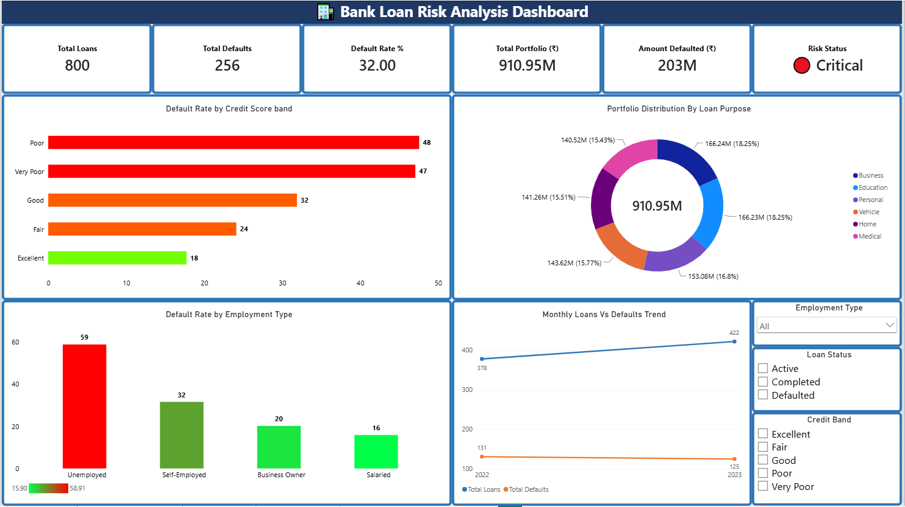
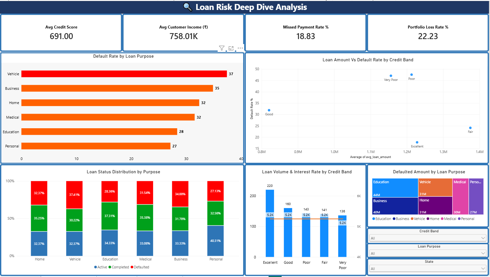
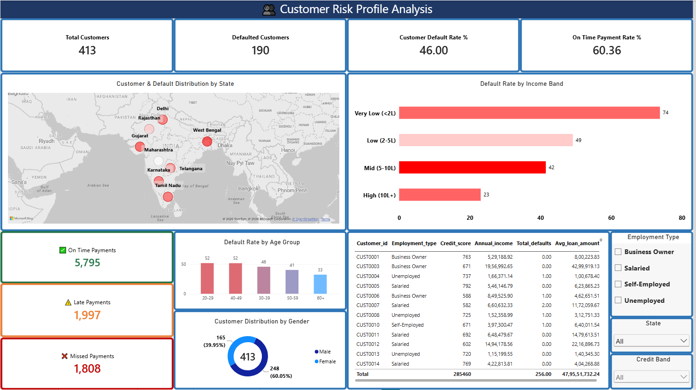
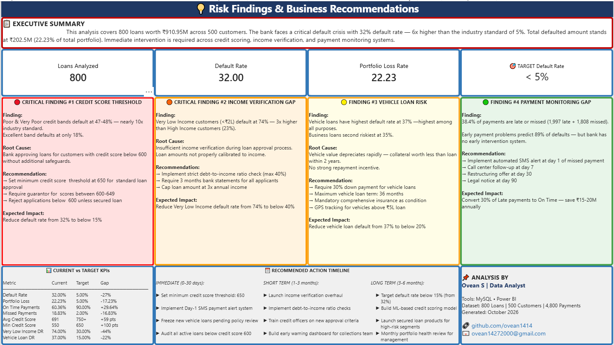

# 🏦 Bank Loan Risk Analysis

## 📋 Business Problem
National Credit Bank faces a critical loan default 
crisis with losses mounting across multiple customer 
segments. Management needs data-driven insights to 
identify high-risk customers BEFORE approving loans.

## 🎯 Objective
Build a complete risk analytics solution to:
- Identify which customer segments default most
- Analyze payment behavior patterns
- Score customers by risk level
- Deliver actionable recommendations to reduce defaults

## 📊 Key Findings

| Finding | Insight |
|---------|---------|
| 🔴 Default Rate | 32% — 6x higher than industry standard |
| 💰 Portfolio Loss | ₹202.5M lost (22.23% of total portfolio) |
| 📉 Credit Risk | Poor credit band defaults at 48% vs Excellent 18% |
| 💼 Employment Risk | Unemployed defaults at 59% vs Salaried 16% |
| 🚗 Vehicle Loans | Highest default purpose at 37% |
| 💵 Income Risk | Very Low Income defaults at 74% |

## 🛠️ Tools & Techniques

| Tool | Usage | Techniques |
|------|-------|-----------|
| MySQL | Database design + Analysis | Stored Procedures, CTEs, Window Functions, Views, JOINs |
| Power BI | Interactive Dashboard | DAX Measures, CALCULATE, SWITCH, Relationships, Map Visual |

## 🗄️ Database Design

## 📸 Dashboard Screenshots

### Page 1 — Executive Risk Summary

### Page 2 — Risk Deep Dive

### Page 3 — Customer Analysis

### Page 4 — Business Recommendations

## 💡 Business Recommendations

1. **Set credit score minimum at 650** — reject below 600
2. **Implement income verification** — cap loans at 3x annual income
3. **Require 30% down payment** for vehicle loans
4. **Launch Day-1 SMS alert** for missed payments

## 🎯 Expected Impact
- Reduce default rate from 32% → below 15%
- Save ₹50-60M annually in prevented defaults
- Improve on-time payment rate from 60% → 90%

## 👨‍💻 Analyst
**Ovean S** | Data Analyst
📧 ovean14272000@gmail.com
🔗 [LinkedIn](https://www.linkedin.com/in/ovean-sugirdas)
🐙 [GitHub](https://github.com/ovean1414)

## 📌 Dataset Note
The data in this project is synthetic, generated using 
[Python / MySQL stored procedures] to simulate realistic 
patterns. The business scenario is fictional. The goal is 
to demonstrate end-to-end analytics skills: data modeling, 
SQL analysis, DAX and dashboard design.
